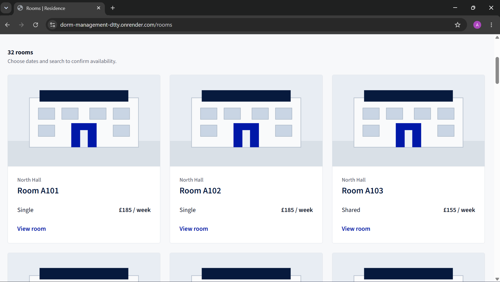
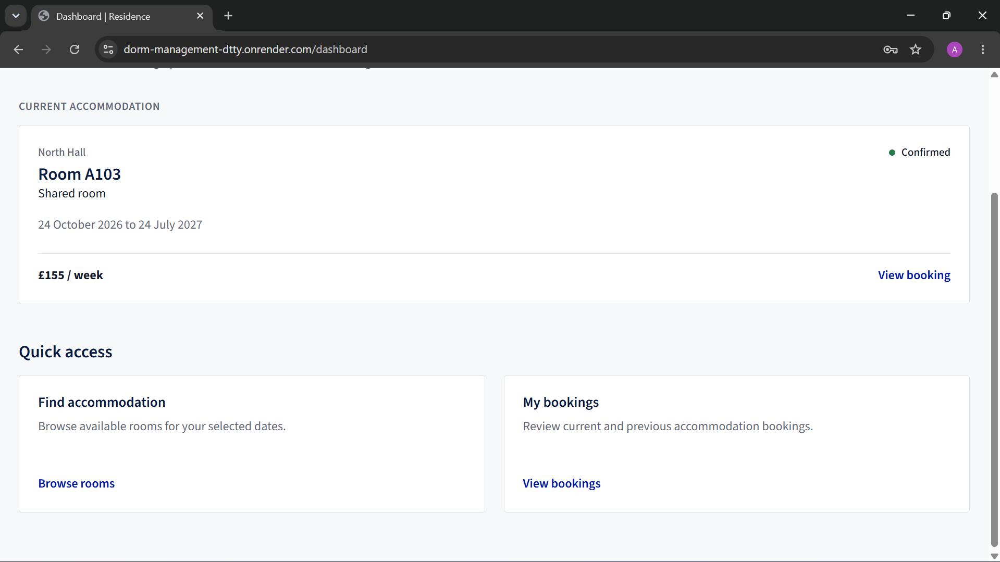
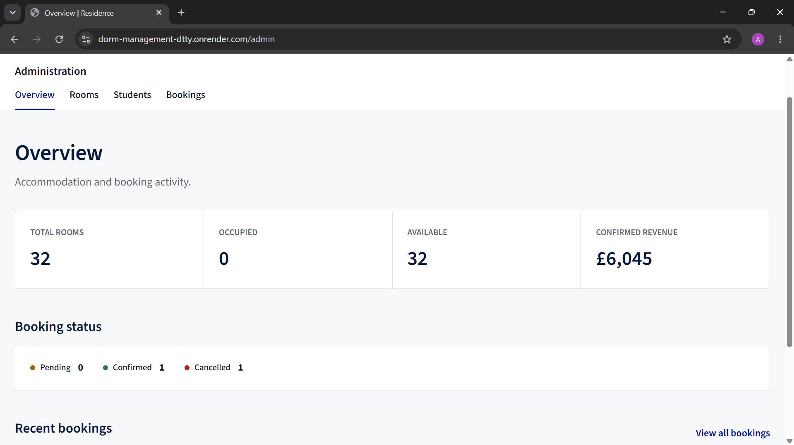

# Dorm Management System
[](https://github.com/AmineBouaiche/dorm-management/actions/workflows/ci.yml) · [Live Demo](https://dorm-management-dtty.onrender.com/)
A production-deployed accommodation management platform built with FastAPI, PostgreSQL, and a framework-free frontend. Students can discover rooms, manage bookings, and track accommodation status, while administrators manage inventory, booking decisions, student records, analytics, and audit activity. The backend emphasizes transactional integrity, role-based authorization, production security, automated testing, and operational observability.


## Screenshots

### Student room discovery


### Student dashboard


### Administration



## Tech Stack

- **Backend:** Python 3.13, FastAPI, SQLAlchemy 2, Pydantic
- **Database:** PostgreSQL, Alembic
- **Authentication & Security:** JWT, Argon2id, CSRF protection, rate limiting
- **Frontend:** HTML, CSS, JavaScript
- **Testing & Quality:** pytest, Ruff, pip-audit
- **Infrastructure:** Docker, Docker Compose, GitHub Actions, Render

## Features

### Public
- Register a student account
- Sign in through secure browser authentication
- Browse active residences and rooms
- Query active room availability for a date range

### Student
- Read own profile
- Create bookings using authenticated identity
- Read own booking history
- Cancel own bookings


### Admin
- Create and update residences
- Create and update rooms
- Activate/deactivate residences and rooms without deleting history
- List all inventory, including inactive records
- List students
- List all bookings
- Confirm bookings
- Cancel any booking
- Read occupancy, booking-status and confirmed-revenue analytics


## Architecture

The application uses a modular monolithic architecture. A single FastAPI service serves both the REST API and frontend, while PostgreSQL provides persistent relational storage.


```text
Browser
   |
   | HTTPS
   v
FastAPI Application
   |
   |-- Authentication & RBAC
   |-- Room & Residence Management
   |-- Booking Service
   |-- Admin & Analytics
   |-- Audit Logging
   |
   | SQLAlchemy
   v
PostgreSQL

```
The application is containerized with Docker and deployed on Render with managed PostgreSQL. GitHub Actions provides the CI pipeline for automated testing, linting, vulnerability scanning, migrations, and production-container validation.


## Design decisions

### Modular monolith

The system is implemented as a single FastAPI application with separated domain modules. For the current scope and deployment scale, a distributed or microservice architecture would add operational complexity without providing a meaningful benefit.

### PostgreSQL

Accommodation and booking data is relational and requires strong consistency. PostgreSQL provides transactional guarantees and database-level constraints for booking integrity.

### Database-enforced booking integrity

Booking conflicts are checked at the service layer for readable API responses and enforced again through PostgreSQL constraints. This protects critical invariants even under concurrent requests.

### Server-side authorization

Authorization is enforced by the API based on authenticated user roles and resource ownership. Frontend visibility is not treated as an authorization boundary.

### Soft deletion

Rooms and residences are deactivated rather than deleted, preserving historical booking records and referential integrity.


## Weekly pricing
Rooms now store `weekly_rate`, not an ambiguous `price` field. Booking totals are calculated by the backend:

```text
billable_weeks = ceil(number_of_days / 7)
booking_amount = weekly_rate * billable_weeks
```

A partial week is billed as a full week.


## Inventory lifecycle

Rooms and residences are never hard-deleted. Both have an `is_active` flag.

- active residence + active room: visible and bookable
- inactive residence or room: hidden from public room discovery and cannot receive new bookings
- historical bookings remain readable


## Booking integrity

Booking correctness is enforced at both the application and database layers.

- pending and confirmed bookings block overlapping reservations for the same room
- students cannot hold overlapping active bookings across different rooms
- service-level validation returns readable conflict responses
- PostgreSQL exclusion constraints provide concurrency-safe enforcement against conflicting bookings

This prevents booking correctness from depending solely on application-level checks.


## Continuous integration

GitHub Actions runs the CI pipeline on pushes and pull requests targeting `main`.

The pipeline:

- provisions PostgreSQL 17
- installs the Python 3.13 application and development dependencies
- applies the complete Alembic migration history
- runs the full pytest suite
- runs Ruff static analysis
- audits Python dependencies for known vulnerabilities with `pip-audit`
- builds and validates the hardened production container

A failing test, lint check, vulnerability audit, migration, or production-container check prevents the CI pipeline from passing.

## Local setup

### Prerequisites

- Python 3.13
- Docker and Docker Compose
- Git

Clone the repository and create the virtual environment:

```powershell
python -m venv .venv
.\.venv\Scripts\Activate.ps1
python -m pip install --upgrade pip
python -m pip install -e ".[dev]"
```

Copy `.env.example` to `.env` and configure the local environment variables.

Start PostgreSQL and apply the migrations:

```powershell
docker compose up -d
alembic upgrade head
```

Populate the development database with demo accommodation data:

```powershell
python scripts\seed_demo_data.py
```

Run the application:

```powershell
uvicorn app.main:app --reload
```

The application is then available at:

```text
http://127.0.0.1:8000
```

Run the development checks with:

```powershell
pytest
ruff check .
python -m pip_audit --skip-editable
```

## Create an administrator

With PostgreSQL running, migrations applied, and the virtual environment active:

```powershell
python scripts/create_admin.py
```

The script prompts for an administrator email and password and creates a user with the `ADMIN` role. Passwords must satisfy the application's password requirements.


## Main API surface

```text
Authentication
POST  /api/auth/register
POST  /api/auth/login
GET   /api/auth/me
POST  /api/auth/logout

Residences
GET   /api/buildings
POST  /api/buildings                    ADMIN
PATCH /api/buildings/{building_id}      ADMIN

Rooms
GET   /api/rooms
GET   /api/rooms/available
GET   /api/rooms/{room_id}
POST  /api/rooms                        ADMIN
PATCH /api/rooms/{room_id}              ADMIN

Students
GET   /api/students/me                  STUDENT

Bookings
POST  /api/bookings                     STUDENT
GET   /api/bookings/me                  STUDENT
PATCH /api/bookings/{id}/cancel         STUDENT (owner only)

Administration
GET   /api/admin/buildings              ADMIN
GET   /api/admin/rooms                  ADMIN
GET   /api/admin/students               ADMIN
GET   /api/admin/bookings               ADMIN
PATCH /api/admin/bookings/{id}/confirm  ADMIN
PATCH /api/admin/bookings/{id}/cancel   ADMIN
GET   /api/admin/analytics              ADMIN
GET   /api/admin/audit-logs             ADMIN

Operations
GET   /health
```


## Testing

The project includes 115 automated tests covering:

- authentication and role-based authorization
- residence and room APIs
- booking creation, cancellation, conflicts, and lifecycle
- database constraints and transactional integrity
- student and administrator workflows
- pagination and input validation
- rate limiting and abuse controls
- CSRF and browser-session security
- security headers and production configuration
- request tracing and administrative audit logging
- frontend routes and application behavior
- production container hardening

The test suite runs automatically in GitHub Actions and must pass before CI succeeds.

## Test database isolation

The automated test suite uses a dedicated PostgreSQL test database separate from the development database.

At the beginning of each test session, Alembic rebuilds the schema from the migration history. Each test runs inside an isolated transaction/savepoint that is rolled back afterward, preventing test data from leaking between cases.

Run the full suite with:

```powershell
pytest
```


## Production deployment

The application is deployed on Render as a Dockerized FastAPI service backed by managed PostgreSQL.

The production environment:

- serves the application exclusively over HTTPS
- applies Alembic migrations during container startup
- runs as a non-root user with a read-only application filesystem
- disables development endpoints such as `/docs`, `/redoc`, `/openapi.json`, and `/style-guide`
- requires a strong production JWT secret
- connects to PostgreSQL over Render's private network
- exposes `/health` for service health checks

Required production configuration:

```env
ENVIRONMENT=production
DATABASE_URL=postgresql+psycopg://...
JWT_SECRET_KEY=<strong-random-secret>
```

Database credentials and application secrets are supplied through environment variables and are never stored in the repository.


## Security

Security controls are enforced across authentication, authorization, browser interaction, API access, and the production runtime.

- JWT authentication with issuer, audience, issue-time, and expiry validation
- role-based authorization for student and administrator operations
- Secure, HttpOnly, SameSite authentication cookies in production
- CSRF protection for authenticated state-changing browser requests
- Argon2id password hashing with transparent migration of legacy hashes
- 12–128 character password requirements
- HTML escaping of dynamic frontend values and Content Security Policy enforcement
- security headers protecting against clickjacking, MIME sniffing, unnecessary browser permissions, and unsafe referrer behavior
- 64 KiB request-body limits
- rate limiting for authentication and registration abuse
- generic authentication failures to reduce account enumeration
- production-only disabling of development endpoints

The current rate limiter is process-local and designed for the application's single-instance deployment. A horizontally scaled deployment would require a shared rate-limit store.


## Supply-chain security

Dependency and build security are integrated into the development workflow:

- Dependabot monitors Python dependencies, GitHub Actions, and the Docker base image
- `pip-audit` checks the resolved Python environment for known vulnerabilities
- dependency updates run through the complete CI test, lint, migration, vulnerability, and container-build gates
- GitHub Actions uses read-only permissions and does not persist checkout credentials
- production container builds are validated as part of CI

Security checks are treated as CI requirements rather than optional development tooling.

## Resilience and observability

Collection endpoints use bounded pagination with deterministic ordering to prevent unbounded responses. Production requests receive an `X-Request-ID` correlation identifier, while unhandled application errors return generic responses without exposing internal details.

Application request logs intentionally exclude query strings, request bodies, cookies, authorization headers, passwords, tokens, and other sensitive values.

Privileged administrative mutations generate persistent audit records containing the acting administrator, action, affected resource, request ID, timestamp, and minimal non-sensitive change metadata.

The audit trail covers:

- residence creation and updates
- room creation and updates
- booking confirmation and cancellation

Administrators can review audit records through the paginated `/api/admin/audit-logs` endpoint.

### Project status

The application is feature-complete for its intended scope and deployed to production.

The current architecture targets a single application instance. Horizontal scaling would require infrastructure changes such as a shared rate-limit store and separate migration orchestration.

## Project structure

```text
app/
├── api/            API routes and HTTP endpoints
├── core/           Configuration and security
├── db/             Database session and engine configuration
├── models/         SQLAlchemy database models
├── schemas/        Pydantic request/response schemas
└── services/       Application business logic

frontend/
├── assets/         Residence images and static assets
├── css/            Design system, shared styles and page styles
├── js/             API client and frontend application logic
└── pages/          Application HTML pages

migrations/         Alembic migration history
scripts/            Admin creation and demo-data utilities
tests/              API, integration, frontend and security tests
.github/workflows/  GitHub Actions CI pipeline

Dockerfile          Hardened production container
docker-compose.yml  Local PostgreSQL and container configuration
alembic.ini         Alembic configuration
pyproject.toml      Python dependencies and tooling configuration
```

## License

This project is licensed under the MIT License. See [LICENSE](LICENSE) for details.